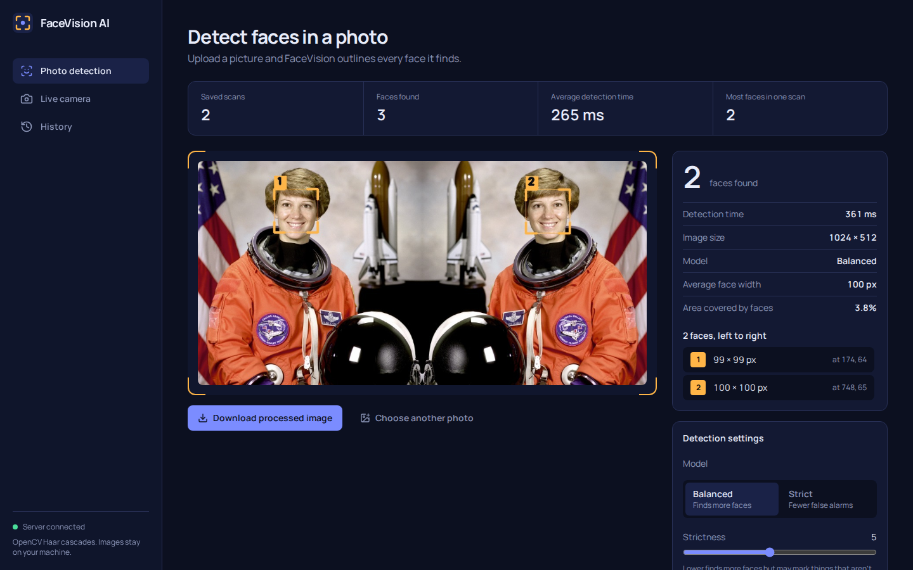
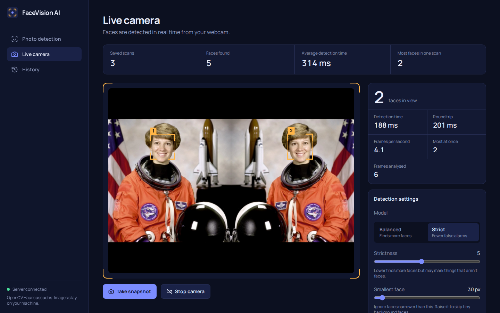

# FaceVision AI

An OpenCV face detection platform with a dark, responsive dashboard. Upload photos, watch faces get detected live through your webcam, download the processed images, and browse your recent detection history.

**Stack:** React + Vite + Tailwind CSS (frontend) · Python Flask + OpenCV + NumPy (backend) · SQLite (history)



## Features

| Feature | How it works |
| --- | --- |
| Upload photos and detect faces | Drag and drop (or choose) a JPG, PNG, BMP or WebP. Flask validates it, OpenCV finds the faces. |
| Real-time webcam detection | The browser grabs a small frame, sends it to `/api/detect-frame`, and draws the returned boxes on a canvas over the live video. |
| Bounding boxes | Amber corner brackets with a number on each face, drawn on saved images by OpenCV and on the live video by the canvas. |
| Face counting | Every result shows how many faces were found, plus each face's size and position. |
| Processing time and statistics | Detection time, image size, average face width, area covered, live FPS and round-trip time, and totals across saved scans. |
| Download processed images | One click on any result or history item (`<name>_faces.jpg`). |
| Recent history | The last 50 scans are stored in SQLite with thumbnails. Reopen, download or delete them. |
| Responsive dark dashboard | Sidebar on desktop, bottom navigation on phones. |



## Requirements

* **Python 3.9 or newer** (tested on 3.12)
* **Node.js 18 or newer** (tested on 22) with npm
* A webcam for the live feature (optional)

## Setup

Open **two terminals** in the project folder.

### 1. Backend (terminal 1)

macOS / Linux:

```bash
cd backend
python3 -m venv .venv
source .venv/bin/activate
pip install -r requirements.txt
python app.py
```

Windows (PowerShell):

```powershell
cd backend
python -m venv .venv
.venv\Scripts\Activate.ps1
pip install -r requirements.txt
python app.py
```

You should see `FaceVision AI API running at http://127.0.0.1:5001`.

### 2. Frontend (terminal 2)

```bash
cd frontend
npm install
npm run dev
```

Open **http://localhost:5173**. The status light in the sidebar turns green when the frontend can reach the backend.

> Use `localhost` (not your LAN IP) for the webcam. Browsers only allow camera access on `localhost` or HTTPS pages.

### Optional: run everything from one server

```bash
cd frontend && npm run build        # creates frontend/dist
cd ../backend && python app.py      # Flask now also serves the UI
```

Then open **http://127.0.0.1:5001**.

## Try it quickly

The `samples/` folder has two images to try: `astronaut.jpg` (1 face) and `two-faces.jpg` (2 faces). Both come from NASA / scikit-image's public-domain test photo.

## Running the tests

```bash
cd backend
pytest
```

The 19 tests cover detection, multiple faces, both models, validation errors (wrong type, fake image, empty, tiny, oversized), the webcam endpoint, downloads, history, statistics and automatic cleanup.

## Project structure

```
FaceVisionAI/
├── backend/
│   ├── app.py            Flask app and all API routes
│   ├── detector.py       OpenCV Haar cascade detection + box drawing
│   ├── validators.py     Image and settings validation
│   ├── database.py       SQLite history store
│   ├── config.py         Settings (port, limits), overridable via env vars
│   ├── requirements.txt
│   └── tests/            pytest suite and fixtures
├── frontend/
│   ├── package.json
│   ├── vite.config.js    Dev server and /api proxy to Flask
│   ├── tailwind.config.js
│   └── src/
│       ├── App.jsx            Layout, tabs, shared state
│       ├── api/client.js      Every call to the backend
│       ├── hooks/useWebcam.js Camera permission and stream handling
│       ├── lib/               Canvas drawing, validation, formatting
│       └── components/        DetectPanel, WebcamPanel, HistoryPanel, ...
├── samples/              Test images
└── docs/                 Screenshots
```

## How detection works

1. The image is decoded with `cv2.imdecode`. This is also the real validity check: a text file renamed to `.jpg` fails here.
2. It is converted to grayscale and contrast-equalised, then shrunk if its longest side is over 1600 px (boxes are scaled back to the original size).
3. `CascadeClassifier.detectMultiScale` returns face rectangles using one of two bundled Haar cascades:
   * **Balanced** (`haarcascade_frontalface_default`) finds more faces.
   * **Strict** (`haarcascade_frontalface_alt2`) gives fewer false alarms.
4. Boxes are drawn on a copy of the image, saved as JPEG with a thumbnail, and recorded in SQLite.

**Settings in the UI**

* *Strictness* maps to `minNeighbors`. Lower finds more faces but also more false ones.
* *Smallest face* maps to `minSize`. Raise it to ignore tiny background faces.

**Good to know:** Haar cascades are fast and need no downloads, but they work best on faces that look roughly straight at the camera in decent light. Heavily turned, tilted or covered faces can be missed.

## API reference

All errors return `{"error": {"code": "...", "message": "..."}}` with a suitable status code.

| Method | Endpoint | Description |
| --- | --- | --- |
| GET | `/api/health` | Server status and available models |
| POST | `/api/detect` | Multipart: `image` (file), optional `model`, `min_neighbors`, `min_size`, `source`. Detects, saves, returns result (201) |
| POST | `/api/detect-frame` | Multipart: `frame` (JPEG). Returns boxes only, saves nothing (used by the webcam loop) |
| GET | `/api/history?limit=20` | Recent detections, newest first |
| GET | `/api/history/<id>/image` | Processed image (inline) |
| GET | `/api/history/<id>/thumbnail` | Thumbnail |
| GET | `/api/history/<id>/download` | Processed image as a download |
| DELETE | `/api/history/<id>` | Delete one detection and its files |
| DELETE | `/api/history` | Delete all detections |
| GET | `/api/stats` | Totals across saved scans |

Example:

```bash
curl -F image=@samples/two-faces.jpg http://127.0.0.1:5001/api/detect
```

## Configuration

Set environment variables before `python app.py`:

| Variable | Default | Meaning |
| --- | --- | --- |
| `FACEVISION_PORT` | `5001` | API port |
| `FACEVISION_HOST` | `127.0.0.1` | Bind address |
| `FACEVISION_MAX_UPLOAD_MB` | `10` | Upload size limit |
| `FACEVISION_MAX_HISTORY` | `50` | Scans kept before the oldest are removed |
| `FACEVISION_DATA_DIR` | `backend/data` | Where the database and images are stored |
| `FACEVISION_DEBUG` | `0` | Set to `1` for Flask debug mode |

If you change the port, tell the frontend too: `VITE_API_PROXY=http://127.0.0.1:PORT npm run dev`.

## Troubleshooting

**"The server isn't responding" banner.** The backend isn't running. Start it with `python app.py` in `backend/` (with the virtual environment activated).

**`CascadeClassifier` is missing / `AttributeError` from cv2.** You have OpenCV 5.x, which removed Haar cascades. `requirements.txt` pins `opencv-python-headless<5`. Run `pip install -r requirements.txt` again.

**Port 5001 is already in use.** Set `FACEVISION_PORT=5002` and start the frontend with `VITE_API_PROXY=http://127.0.0.1:5002`.

**Camera won't start.** The app shows a specific message. Usually: click the camera icon in the address bar and allow access; close other apps using the webcam; and open the site via `http://localhost:5173`, not an IP address.

**Live detection feels slow.** Frames are sent to Flask over HTTP, so speed depends on your CPU. Raise *Smallest face* in the settings to speed up scanning, and use the Balanced model.

## Privacy

Everything runs locally. Photos and video frames go only to your own Flask server. Webcam video is never stored; only snapshots you take explicitly are saved. Saved images live in `backend/data/`.

## Credits

Sample photo: NASA, public domain (via scikit-image). Face detection uses OpenCV's bundled Haar cascades.
# -FaceVision-AI-

